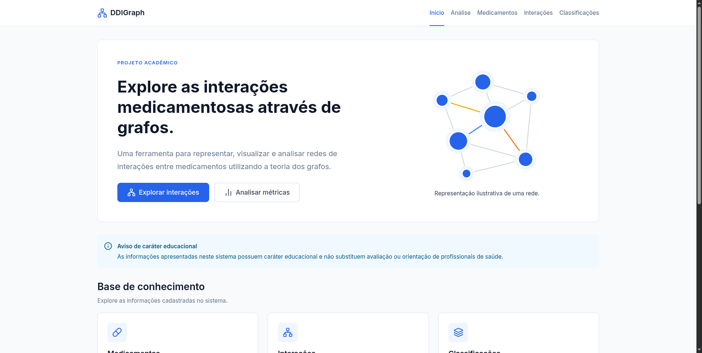
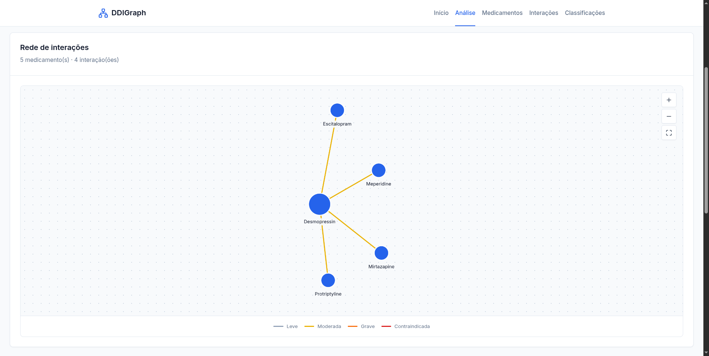
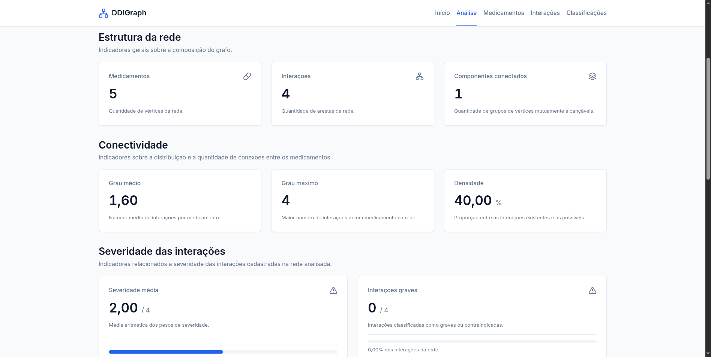
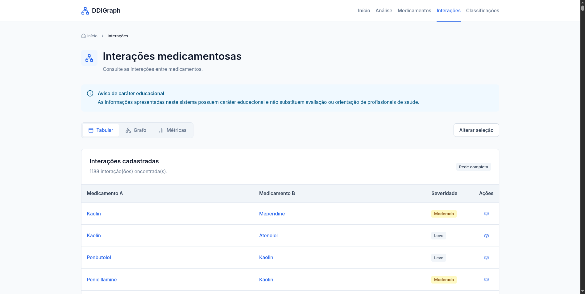
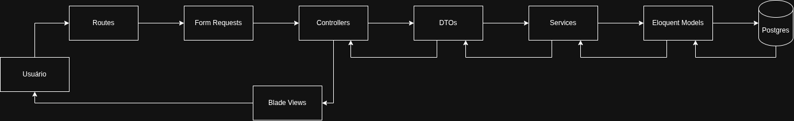
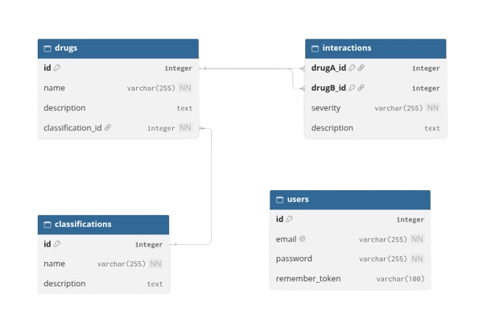
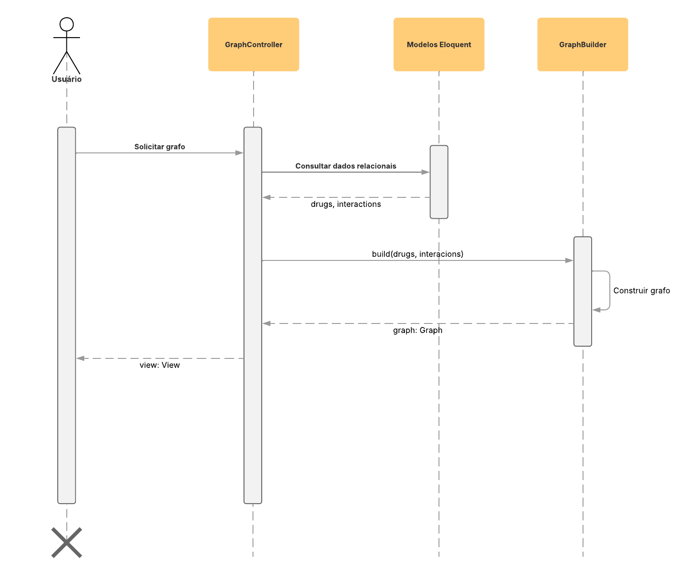
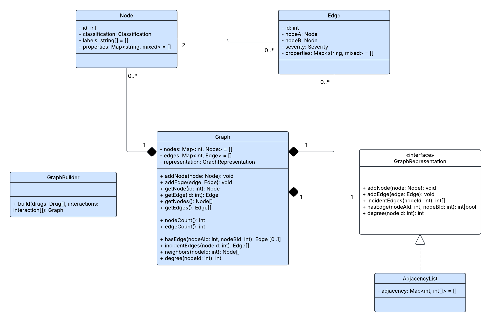
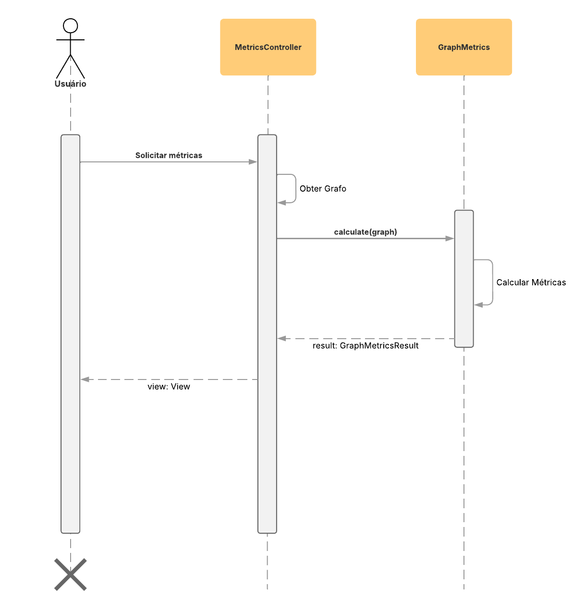
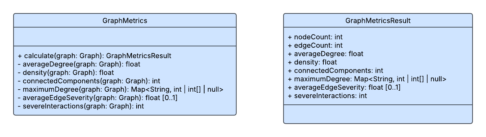

# DDI-Graph



**Sistema web para Representação de Interações Medicamentosas por em Grafos**

## Introdução

O **DDI-Graph (Drug–Drug Interactions Graph)** é um sistema web desenvolvido como parte do Trabalho de Conclusão de Curso (TCC) de Técnico em Informática do Instituto Federal do Paraná (IFPR), campus Paranaguá, intitulado *Desenvolvimento de um sistema web para representação de interações medicamentosas por meio de modelagem em grafos* (2026), de Victor Pecine Marques, Hanae Rosa Terato Ramos e Everaldo Silva de Freitas.

O projeto investiga a conversão de dados relacionais em estruturas de grafos em memória como estratégia complementar de representação e análise de domínios altamente conectados, utilizando as interações medicamentosas como estudo de caso.

Os dados são armazenados em um banco de dados relacional e convertidos, sob demanda, em um grafo simples, não direcionado e com atributos associados aos seus elementos:

- **Vértices:** medicamentos, identificados por seu princípio ativo e associados a uma classificação terapêutica.
- **Arestas:** interações entre dois medicamentos distintos, associadas a um nível de gravidade e, opcionalmente, a uma descrição.

A abordagem permite explorar visualmente os relacionamentos e executar algoritmos de grafos sem substituir a infraestrutura de persistência relacional. A pesquisa avalia a integridade da conversão, seu desempenho e consumo de memória, a equivalência de operações nas duas representações e a capacidade de análise estrutural da rede.

> **Aviso:** este sistema possui finalidade acadêmica, educacional e computacional. Os dados não foram validados clinicamente pelos autores. A ausência de uma interação no sistema não significa que ela não exista. O sistema não deve ser utilizado para decisões clínicas, prescrição ou orientação sobre medicamentos.

**Artigo disponível em** `docs/artigo.pdf` 

## Tecnologias

|| Tecnologia | Versão | Finalidade |
| --- | --- | --- | --- |
|[](https://skillicons.dev)| PHP | 8.5.12 | Linguagem do backend e implementação dos algoritmos |
|[](https://skillicons.dev)| Laravel | 13.27.0 | Framework web, autenticação, roteamento e Artisan |
|[](https://skillicons.dev)| PostgreSQL | 18.7 | Persistência relacional |
|[](https://skillicons.dev)| Vite | 8.2.2 | Compilação dos assets do frontend |
|[](https://skillicons.dev)| Cytoscape.js | 3.35.0 | Visualização interativa dos grafos |
|[](https://skillicons.dev)| Python | 3.14.10 | Extração e transformação de dados |

## Features



### Funcionalidades públicas

- Consulta de medicamentos, classificações e interações cadastradas.
- Seleção de um conjunto de medicamentos para análise das interações existentes entre eles.
- Visualização das interações em formato tabular ou em grafo interativo, com diferenciação visual dos níveis de gravidade.
- Geração do grafo completo ou do subgrafo induzido pelos medicamentos selecionados.
- Dashboard de métricas da rede completa ou de uma seleção específica.

### Funcionalidades administrativas

- Autenticação de administradores.
- CRUD de medicamentos, classificações terapêuticas, interações e contas administrativas.
- Validação das regras de negócio e das restrições de integridade, incluindo a prevenção de auto-interações e interações duplicadas.

As consultas públicas não exigem cadastro ou autenticação. As operações administrativas são protegidas por middleware de autenticação.



### Funcionalidades experimentais

- Extração, normalização e importação de dados farmacológicos provenientes de fontes externas.
- Validação da correspondência entre registros relacionais e elementos do grafo.
- Mensuração do tempo de recuperação dos dados, construção do grafo, cálculo de métricas e consumo de memória.
- Comparação da equivalência e do tempo de execução de operações relacionais e operações sobre grafos previamente construídos em memória.
- Testes unitários e de integração/funcionalidade desenvolvidos com Pest, seguindo a abordagem TDD (*Test-Driven Development*).



## Como rodar

### 1. Pré-requisitos

- PHP 8.4.1+
- Composer 2+
- PostgreSQL 18.7+
- Node.js 22+
- Python 3.9+
- Git

### 2. Instalação e configuração

Clone o repositório e instale as dependências:

```bash
git clone https://github.com/victor-marquesp/ddi-graph.git
cd ddi-graph

composer install
npm ci
cp .env.example .env
php artisan key:generate
```

Crie um banco no PostgreSQL, por exemplo `"ddi-graph"` e configure a conexão no arquivo `.env` conforme o ambiente local:

```dotenv
DB_CONNECTION=pgsql
DB_HOST=127.0.0.1
DB_PORT=5432
DB_DATABASE=ddi_graph
DB_USERNAME=seu_usuario
DB_PASSWORD=sua_senha
```

Execute as migrations e compile os assets:

```bash
php artisan migrate
npm run build
```

### 3. Povoamento do banco de dados

**Opção A — Seeders de demonstração:**

```bash
php artisan db:seed
```

**Opção B — Dataset experimental:**

Por questões de licenciamento, os conjuntos de dados originais e processados não são distribuídos neste repositório. Entretanto, são disponibilizados os scripts necessários para sua preparação e importação, possibilitando a reprodução dos experimentos.

Obtenha os seguintes arquivos em suas respectivas fontes:

| Fonte | Arquivos |
| --- | --- |
| [DDInter](https://ddinter.scbdd.com/download/) | `ddinter_downloads_code_*.csv` |
| [mnarayan1/DDInter](https://github.com/mnarayan1/DDInter) | `drug_data.json` |
| [ATC-drugs-class.db](https://github.com/theoffbeatdoc/ATC-drugs-class.db) | `drugs_atc.json` e `drugs_list.json` |

Disponha os arquivos no diretório `database/datasets/raw/`, observando as condições de licenciamento de suas respectivas fontes.

**Mais dados sobre as datas, versões e integridade dos arquivos utilizados originalmente no projeto estão listadas em [REPRODUCIBILITY](docs/REPRODUCIBILITY.md)**

Para gerar o dataset completo, execute:

```bash
python3 scripts/extract.py
```

Alternativamente, para gerar uma amostra de 200 medicamentos:

```bash
python3 scripts/extract.py --limit 200
```

Os arquivos resultantes serão armazenados em `database/datasets/processed/`.

Para importá-los ao banco de dados, execute:

```bash
php artisan dataset:import
```

O comando `dataset:import` exige que as tabelas de classificações, medicamentos e interações estejam vazias. Para utilizar as funcionalidades administrativas com o dataset importado, crie um administrador de demonstração separadamente:

```bash
php artisan db:seed --class=UserSeeder
```

**Login primário:**

**email:** `admin.test@email.com`  
**senha:** `@1234@5678`

### 4. Execução do sistema

Com os assets já compilados, inicie o servidor de desenvolvimento:

```bash
composer run dev
```

Acesse <http://localhost:8000>.

### 5. Execução dos testes

Crie um banco PostgreSQL separado chamado `ddi_graph_test`, acessível pelas credenciais configuradas no ambiente. O arquivo [`phpunit.xml`](phpunit.xml) seleciona esse banco para os testes. Não utilize o banco experimental ou de produção como banco de testes.

```bash
php artisan config:clear
php artisan test
```

### 6. Reprodução dos benchmarks

> **Atenção:** `migrate:fresh` exclui todas as tabelas do banco configurado. Execute-o apenas em um banco experimental descartável, depois de conferir a conexão e possuir os backups necessários.

```bash
python3 scripts/extract.py
php artisan migrate:fresh
php artisan dataset:import
```

São esperados 1.367 medicamentos e 70.919 interações no conjunto completo. O comando de benchmark seleciona medicamentos em ordem determinística (hash SHA-256 com prefixo fixo `42:` sobre os identificadores internos) e mantém apenas as interações cujas duas extremidades pertencem ao conjunto selecionado. Cada cenário é cumulativo em relação ao anterior.

| Cenário (`--limit`) | Medicamentos | Interações esperadas |
| ---: | ---: | ---: |
| 50 | 50 | 115 |
| 100 | 100 | 401 |
| 200 | 200 | 1.777 |
| 500 | 500 | 10.280 |
| 0 (todos) | 1.367 | 70.919 |

Para executar um cenário individual:

```bash
php -d memory_limit=1024M artisan graph:benchmark --limit=200 --iterations=1000
```

Para reproduzir as 50 execuções independentes, utilize o seguinte script em Bash, a partir da raiz do repositório. Os resultados serão gravados em um novo diretório, preservando os arquivos originais.

```bash
set -e
mkdir -p benchmarks-reproduced

for limit in 50 100 200 500 0; do
    for run in {1..10}; do
        php -d memory_limit=1024M artisan graph:benchmark \
            --limit="$limit" \
            --iterations=1000 \
            > "benchmarks-reproduced/${limit}_${run}.json"
    done
done
```

Cada execução realiza a recuperação dos dados, a conversão para grafo, o cálculo das métricas e a validação da integridade. As operações `hasEdge()`, `neighbors()` e `degree()` são comparadas com consultas relacionais equivalentes, com uma execução de aquecimento e 1.000 repetições cronometradas para cada operação e representação.

Os arquivos JSON contêm os seguintes grupos de resultados:

| Grupo | Conteúdo |
| --- | --- |
| `dataset` | Quantidade de medicamentos e interações selecionados |
| `integrity` | Quantidade de vértices e arestas esperados, gerados e válidos |
| `performance` | Tempos de recuperação, conversão, métricas e consumo de memória |
| `comparison` | Equivalência e tempos médios das operações SQL e de grafo |
| `metrics` | Métricas estruturais e específicas do domínio |

Os resultados originais da pesquisa estão disponíveis em [`benchmarks/`](benchmarks/) e no arquivo [`benchmarks.tar.gz`](benchmarks.tar.gz). Os tempos são armazenados em milissegundos; para a tabela de comparação de operações do artigo, converta-os em microssegundos multiplicando por 1.000. Os campos de memória representam MiB, inclusive quando o nome termina em `_mb`.

> Os experimentos não mensuram o tempo de renderização do Cytoscape.js.

## Arquitetura

O projeto utiliza uma arquitetura MVC (*Model–View–Controller*) estendida com camadas de organização da lógica de negócio, componentes especializados em grafos e comandos CLI. A aplicação é monolítica: a persistência, a conversão dos dados e os algoritmos de análise são coordenados pela mesma aplicação Laravel.

A seguir, são apresentados os fluxos das funcionalidades convencionais e dos módulos Graph, Metrics e Commands.

### Features padrão

As funcionalidades de gerenciamento e consulta de medicamentos, classificações, interações e usuários são organizadas em camadas de apresentação, aplicação e persistência.



| Camada | Diretório | Responsabilidade |
| --- | --- | --- |
| Routes | `routes/` | Definição das rotas e controle de acesso por middleware. |
| Form Requests | `app/Http/Requests/` | Validação dos dados recebidos nas requisições que necessitam de validação. |
| Controllers | `app/Http/Controllers/` | Orquestração das requisições, consultas, chamadas aos serviços, tratamento de exceções e retorno de views ou redirecionamentos. |
| DTOs | `app/DTOs/` | Transferência estruturada dos dados validados às operações de negócio. |
| Services | `app/Services/` | Implementação das operações de manutenção das entidades e das regras de negócio. |
| Models | `app/Models/` | Entidades Eloquent, relacionamentos, conversão de atributos e acesso à persistência. |
| Exceptions / Enums | `app/Exceptions/`, `app/Enums/` | Exceções de domínio e representação enumerada da gravidade. |
| Database | `database/migrations/` | Esquema relacional, chaves, restrições e integridade referencial. |
| Views | `resources/views/`, `resources/css/`, `resources/js/` | Renderização das páginas e componentes Blade, estilos e comportamento da interface. |

O fluxo de escrita normalmente passa por Form Request, Controller, DTO, Service e Model. Consultas simples podem ser feitas diretamente pelos controllers através do Eloquent, sem passar pela camada de serviços. A autenticação utiliza os recursos nativos do Laravel por meio de `AuthController` e `LoginRequest`.

No modelo relacional, `Drug` pertence a uma `Classification`, e `Interaction` conecta dois registros de `Drug`. A tabela `interactions` utiliza uma chave primária composta (`drugA_id`, `drugB_id`) e uma restrição de ordenação (`drugA_id < drugB_id`) que impede auto-interações e representações duplicadas do mesmo par.



### Graph

O módulo [`app/Graph/`](app/Graph/) implementa a estrutura de grafo em memória e o processo de conversão dos dados relacionais, separando a representação utilizada para análise da estrutura de persistência.



| Componente | Responsabilidade |
| --- | --- |
| `GraphController` | Recupera os registros relacionais, solicita a construção e a serialização do grafo e retorna a view. |
| `SelectedGraphRequest` | Valida os identificadores dos medicamentos selecionados. |
| `GraphBuilder` | Converte os objetos `Drug` e `Interaction` em objetos `Node` e `Edge`, respectivamente. |
| `Graph` | Armazena os vértices e as arestas, controla a integridade da estrutura e disponibiliza as operações de grafo. |
| `Node` | Representa um medicamento, com identificador, classificação, rótulos e propriedades. |
| `Edge` | Representa uma interação não direcionada, com identificador interno, dois vértices, gravidade e propriedades. |
| `GraphRepresentation` | Interface que define as operações da representação interna. |
| `AdjacencyList` | Implementação da interface por meio de listas de identificadores das arestas incidentes em cada vértice. |
| `CytoscapeSerializer` | Converte a estrutura de grafo para o formato de elementos esperado pelo Cytoscape.js. |



O padrão de projeto **Strategy** é empregado para desacoplar `Graph` de sua representação interna. O grafo delega operações relacionadas à adjacência à implementação de `GraphRepresentation`, permitindo que outras estratégias sejam implementadas futuramente sem alterar sua interface pública.

O `GraphBuilder` recebe os dados já recuperados pelos controllers ou comandos: primeiro constrói os vértices e depois as arestas, preservando os identificadores dos medicamentos e os atributos avaliados. As arestas recebem identificadores internos próprios. As operações disponíveis incluem `getNode()`, `getEdge()`, `nodeCount()`, `edgeCount()`, `hasEdge()`, `incidentEdges()`, `neighbors()` e `degree()`.

O grafo não é persistido em um banco orientado a grafos: é construído na camada de aplicação conforme a necessidade da operação. Embora a estrutura possua classes próprias, `Node` mantém uma referência ao modelo `Classification` do domínio.

Rotas públicas: `/graph/all` e `/graph/selected` (com `drug_ids[]`).

### Metrics

O módulo Metrics utiliza a estrutura produzida pelo módulo Graph para calcular propriedades estruturais da rede e métricas específicas das interações medicamentosas, sem incorporar os algoritmos de análise à classe `Graph`.



| Componente | Responsabilidade |
| --- | --- |
| `MetricsController` | Recupera os dados, constrói o grafo, solicita as métricas e serializa os elementos utilizados na interface. |
| `GraphMetrics` | Implementa os algoritmos de cálculo das métricas sobre um objeto `Graph`. |
| `GraphMetricsResult` | Objeto de resultado imutável (`readonly`) que agrega as métricas calculadas. |
| `CytoscapeSerializer` | Prepara os elementos do grafo para a interface do dashboard. |
| `graph/dashboard.blade.php` | Apresenta as métricas e os elementos de visualização ao usuário. |



Os cálculos utilizam operações da própria estrutura de grafo, incluindo busca em profundidade iterativa (DFS) para a contagem de componentes conexos. A separação entre `Graph`, `GraphMetrics` e `GraphMetricsResult` permite reutilizar os algoritmos também fora das interfaces web, como no comando de benchmark.

Rotas públicas: `/metrics/all` e `/metrics/selected` (com `drug_ids[]`).

### Commands

Os comandos Artisan em [`app/Console/Commands/`](app/Console/Commands/) possibilitam executar as etapas de carregamento e avaliação experimental sem depender da interface web. O script Python realiza a preparação dos dados antes da importação.

| Componente | Responsabilidade |
| --- | --- |
| `scripts/extract.py` | Combina os dados DDInter com os identificadores DrugBank e códigos ATC; elimina pares inválidos, duplicidades e conflitos de gravidade; remove medicamentos sem classificação inequívoca de segundo nível; gera os CSVs normalizados. |
| `ImportDataset` (`dataset:import`) | Importa classificações, medicamentos e interações em uma transação, resolve identificadores externos em chaves internas e insere as interações em lotes de mil registros. |
| `GraphBenchmark` (`graph:benchmark`) | Seleciona os medicamentos, recupera os dados, constrói o grafo, verifica a integridade, calcula as métricas, compara operações e emite os resultados em JSON. |
| `database/seeders/` | Povoamento alternativo para demonstração e criação do administrador inicial. |
| `benchmarks/` | Resultados das 50 execuções experimentais originais. |

Os testes automatizados encontram-se em `tests/Unit/` (estrutura, conversão e métricas de grafos) e `tests/Feature/` (autenticação, CRUDs, rotas e serialização). As factories em `database/factories/` auxiliam na preparação dos dados de teste.

## Licença

O código-fonte autoral do DDI-Graph é disponibilizado sob a licença [MIT](LICENSE).

O projeto foi desenvolvido como Trabalho de Conclusão de Curso do curso Técnico em Informática do Instituto Federal do Paraná (IFPR) - Campus Paranaguá.

### Dados experimentais

As bases de dados utilizadas nos experimentos possuem condições próprias de licenciamento:

- [DDInter](https://ddinter.scbdd.com/): CC BY-NC-SA 4.0.
- [mnarayan1/DDInter](https://github.com/mnarayan1/DDInter): sem licença própria explicitamente declarada.
- [ATC-drugs-class.db](https://github.com/theoffbeatdoc/ATC-drugs-class.db): CC BY-SA 4.0.

Os conjuntos de dados originais e processados não são distribuídos neste repositório, cabendo ao usuário obtê-los em suas respectivas fontes e observar suas condições de utilização.

São disponibilizados os scripts de processamento, os procedimentos experimentais e os resultados agregados obtidos durante a pesquisa, visando à sua reprodutibilidade.

A licença MIT não se estende aos dados ou aos componentes de terceiros.
